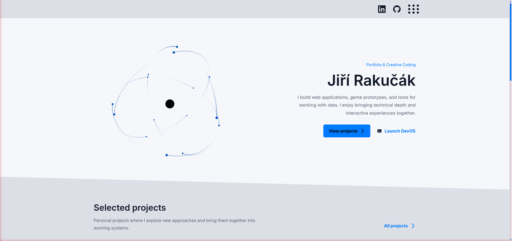

# Jiří Rakučák | Portfolio

A personal portfolio built with React and TypeScript, combining bilingual project case studies with an interactive Three.js homepage and an experimental desktop environment called **DevOS**.

This is both the source of my portfolio and a place to explore frontend architecture, accessible interactions, and real-time graphics. The public website is the main product; DevOS is an ongoing experiment.

[**Live demo →**](http://92.5.37.51/) — currently hosted on a temporary IP address, without a domain.

[](http://92.5.37.51/)

[Getting Started](#getting-started) · [Technical Decisions](#technical-decisions) · [Project Structure](#project-structure) · [Documentation](#documentation)

## Highlights

- **English and Czech:** localized interface and project content, with language switching on the same URLs.
- **Responsive interface:** project case studies and skills, with a text-first mobile introduction.
- **Optional 3D scene:** an interactive desktop atom scene with bounded mouse tilt and reduced-motion support.
- **DevOS:** an experimental desktop environment for exploring the portfolio through windows and a terminal.

## Built With

| Area | Technologies |
| --- | --- |
| Application | React 19, TypeScript 6, Vite 8 |
| Navigation | React Router 7 |
| Styling and localization | styled-components 6, i18next, react-i18next |
| Graphics | Three.js, React Three Fiber, Drei, React Spring |
| Quality | Vitest, ESLint 10, TypeScript checks |

The ASP.NET shell in `Web.Server/` is parked. The portfolio runs as a static frontend and does not need a backend, database, or API keys.

## Technical Decisions

**One content model, multiple views.** Localized JSON holds project and skill content; typed accessors keep public pages and DevOS consumers aligned. Adding a project does not require adding a route or copying metadata into components.

**Load graphics separately.** DevOS and the Three.js scene are lazy-loaded independently of the public pages. The homepage scene has an error boundary, so a rendering failure does not remove navigation or the introduction.

**Build accessible interactions.** Native buttons, links, radio inputs, and dialogs support keyboard navigation and modal focus containment. Reduced-motion preferences disable homepage animation and page transitions.

## Getting Started

Requirements: **Node.js 20.19+ and npm**, using a version supported by the installed Vite release.

From the repository root:

```bash
cd web.client
npm ci
npm run dev
```

The default port is **60522**. Use the URL printed by Vite: normally `http://localhost:60522/`, or HTTPS when existing local development PEM certificates are available. Set `DEV_HTTPS=false` to force HTTP or `DEV_SERVER_PORT` to change the port.

No .NET SDK or development certificates are needed to build the frontend.

### Checks and Build

Run from `web.client/`:

```bash
npm run lint
npm run test
npm run build
npm run preview
```

The build produces `web.client/dist/`. `npm run preview` serves that build locally; it is not the production hosting setup. Run `npm audit` separately to check dependency advisories.

Tests cover content consistency, route metadata, component markup, theme persistence, motion math and lifecycle policy, and deployment sequencing with fake transports. They do not replace browser, WebGL, or device testing.

## Project Structure

```text
web.client/
  src/
    Components/    Public UI, preferences, DevOS, and Three.js scene
    Pages/         Homepage, projects, skills, and fallback pages
    content/       Typed access to shared portfolio data
    i18n/          English/Czech UI and content JSON
    metadata/      Route-aware browser metadata
    styles/        Theme state, tokens, and shared styles
  public/          Project screenshots, favicon, and font attribution
  tests/           Node-only deployment tests
deploy/            Static-host configuration and upload script
docs/              Development context, source notes, and deployment guide
Web.Server/        Inactive ASP.NET shell
```

For content edits, start with `web.client/src/i18n/locales/{en,cs}/content.json`. Keep project IDs aligned across languages. Contact details live in `web.client/src/content/contact.ts`.

## Current Status

The public portfolio has an initial responsive implementation for mobile and desktop, with device testing and visual refinements still in progress. DevOS and the login/admin routes remain prototypes; authentication and content management are not functional.

## Related Work

- [Personal Conversation RAG](https://github.com/Jiri-Rakucak/ragsystem): local-first retrieval over conversation exports and notes, featured in the portfolio.
- [Starbounder](https://jirirakucak.itch.io/starbounder): a 2D Unity graduation prototype, presented as a project case study rather than a finished game.

## Documentation

- [Frontend Guide](web.client/README.md): workflow, content model, localization, and implementation details.
- [Deployment](docs/DEPLOYMENT.md): domain-independent hosting templates, upload procedure, and browser checks.

## Credits and Licensing

The JR favicon uses Inter glyph outlines; the [bundled Inter license](web.client/public/licenses/inter-OFL.txt) records the font attribution. Project screenshots are supporting material for their respective case studies.

A project-wide license has not been selected yet. The font license is not a license for the entire repository.
